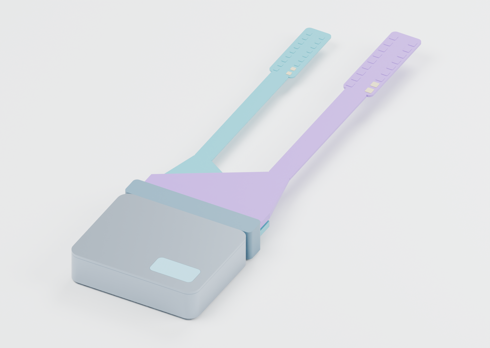
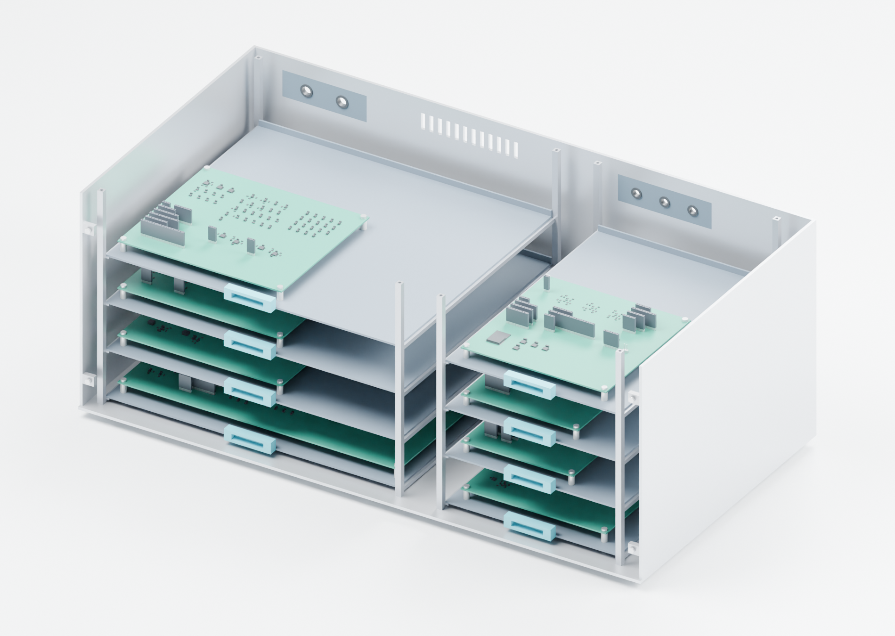

# Project ATO

**An invasive spinal cord-computer interface concept for expert-informed practice and function-specific physiological feedback.**

[Read the integrated manuscript](output/pdf/Project_ATO_Integrated_Manuscript.pdf) · [Start here](START_HERE.md) · [Native CAD](cad/stage5/README.md) · [KiCad boards](electronics/stage4/integrated-pcb/BOARD_INDEX.md) · [v2.0.0 release](https://github.com/pratham-cloud-ctrl/Project-ATO/releases/tag/v2.0.0)



Project ATO connects a future vision to supported reasoning, explicit assumptions,
computational experiments, native electronics, compiled control software and
mechanical design. AstroSam's [Mind-Link](https://github.com/sam-astro/Mind-link)
inspired that progression; the spinal architecture and engineering here are
ATO's own documented, substantially AI-assisted contribution.

**The six-stage digital research and engineering package is complete within its
stated scope.** It includes a 27-page illustrated manuscript, 18 verified
references, both application mechanisms, an executed production-core replay,
eight routed boards, a target-linked image and editable FreeCAD assemblies.
Useful human spinal decoding, accelerated healthy learning, physical performance
and a miniaturized implanted implementation remain explicit future conditions.
No original human/animal experiment or physical device execution is claimed.

## The two mechanisms

**Expert-informed practice.** Expert performance supplies a task-conditioned
coordination reference. Learner-specific calibration aligns the reference,
observations and reachable stimulation programmes. Active practice and later
stimulation-OFF retention are evaluated separately. Expert voltage is not replayed
as a skill, and temporary assistance is not a measured learning multiplier.

**Selected physiological feedback.** A function-specific configuration observes
a state and adjusts bounded spinal stimulation. The pressure reference uses
external pressure sensing and positive pressor authority. It includes saturation,
sensor faults and withdrawal tails. Universal body control is not assumed.

## Review the finished package

| Entry | What it contains |
|---|---|
| [Integrated manuscript](output/pdf/Project_ATO_Integrated_Manuscript.pdf) / [editable source](manuscript/stage6/manuscript.md) | 27 pages; evidence, equations, results, engineering, limitations and population/access register |
| [Evidence and references](docs/stage6/evidence-review.md) | 17 original research reports plus official Mind-Link credit; access, cohort, inference and limits |
| [Integrated digital verification](docs/stage6/integration-verification.md) | Unchanged production C admission/phase code plus declared companion and body adapters |
| [Native electrical system](electronics/stage4/integrated-pcb/BOARD_INDEX.md) | Eight genuinely routed populated boards; 80-sheet master, 1,296 fitted positions and 258 harness rows |
| [Carrier-specific firmware](electronics/stage4/integrated-pcb/firmware-profile/README.md) | nRF5340 ELF/HEX/BIN, configuration, source and byte-level audit; compiled and linked, unflashed |
| [Mechanical CAD](cad/stage5/README.md) / [review sheets](cad/stage5/drawings/ATO_Stage5_Mechanical_Review.pdf) | Full-scale 260-part reference assembly; separate 230-part future package with 36 functional ports; STEP/STL/BOM/launchers |
| [Requirements and claims](docs/stage6/requirements-claims-trace.csv) | All 36 original requirements with current evidence-scoped dispositions |
| [Contributions](docs/stage6/contributions.md) / [defence guide](docs/stage6/defence-guide.md) | Authorship, AI assistance and explanations the student can learn and defend |
| [Release dossier](docs/stage6/README.md) / [current status](CURRENT_STATUS.md) | Completion evidence, reproducibility and remaining research questions |

## Concrete results and their limits

The new integration replay passes **114,426 repeated software assertions across
28 scenario groups**. It includes **5,184 modeled motor events** and **1,200
pressure events**, compiled-core boundary/fault cases and separate ideal
supervisor/feature-validity cases. These are finite software/model results.

| Conditional motor replay | First ON error | Final OFF error |
|---|---:|---:|
| Unassisted | 31.414 mm | 5.605 mm |
| Neutral teaching | 16.668 mm | 5.605 mm |
| Favorable teaching | 16.668 mm | 2.897 mm |
| Adverse teaching | 16.668 mm | 34.845 mm |

The assumed teaching law controls retained benefit. The earlier 128-scenario
conditional study and all-withheld conservative investigation remain preserved,
with their original protocols and results. No unique spinal-information advantage
or healthy acquisition multiplier has been established.

The actual target acquires neural data in **OBSERVE** and inhibits acquisition
while stimulation is armed. Simultaneous live spinal decoding during MOTOR is
not implemented. Synthetic phase features, recruitment and body dynamics in the
host replay are explicit adapters, and the current image has no radio firmware.



The reference chassis is **600 x 310 x 240 mm**, including feet, and keeps the
boards at **1:1 scale**. The separate **60 x 58 x 14 mm** future can/header requires
redesigned integrated electronics, energy storage, thermal closure and qualified
interfaces. Native CAD fit and ERC/DRC do not supply those physical measurements.

## Reproduce

Use a full Git clone at tag `v2.0.0`; install [pinned dependencies](requirements-lock.txt)
in Python 3.12. The [integration entry](experiments/stage6/README.md) explains the
C11 compiler requirement.

```text
python scripts/verify_manifest.py
python scripts/verify_stage6_release.py
python scripts/stage6/verify_digital_path.py
python scripts/verify_stage5_mechanics.py
python scripts/verify_integrated_pcb.py
```

Native application inspection receipts are source-bound and separate from their
portable replay. The [release plan](docs/stage6/release-plan.md) explains full
clones, source ZIPs and external release checksums. The manuscript can be rebuilt
with `python manuscript/stage6/build_figures.py` followed by
`python manuscript/stage6/build_manuscript.py` in the recorded environment.

## Provenance and historical material

Pratham Varma conceived and steered the project. AI assistance contributed
substantially to research synthesis, modeling, implementation, CAD, verification
and writing; see the [contribution record](docs/stage6/contributions.md).
[LICENSE](LICENSE) and component/SDK notices retain the applicable rights.

The [v1.0.0 subsystem reference](https://github.com/pratham-cloud-ctrl/Project-ATO/tree/v1.0.0)
and earlier papers remain historical artifacts, not the current full-system
specification. Prior Stage 1-5 studies, native designs and negative findings are
preserved at their source identities. Video and website revision were parked;
the old site/media files are historical material.
