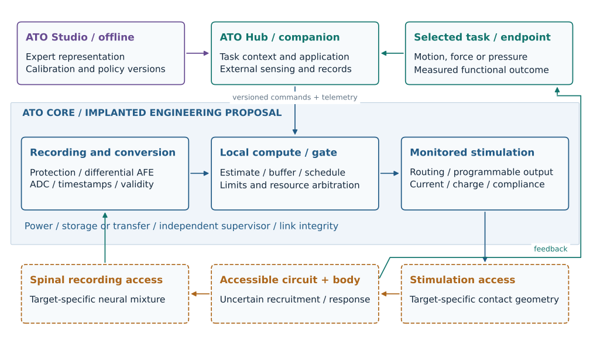
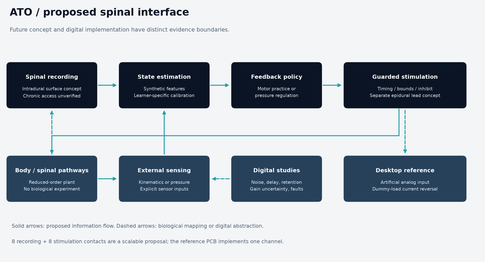
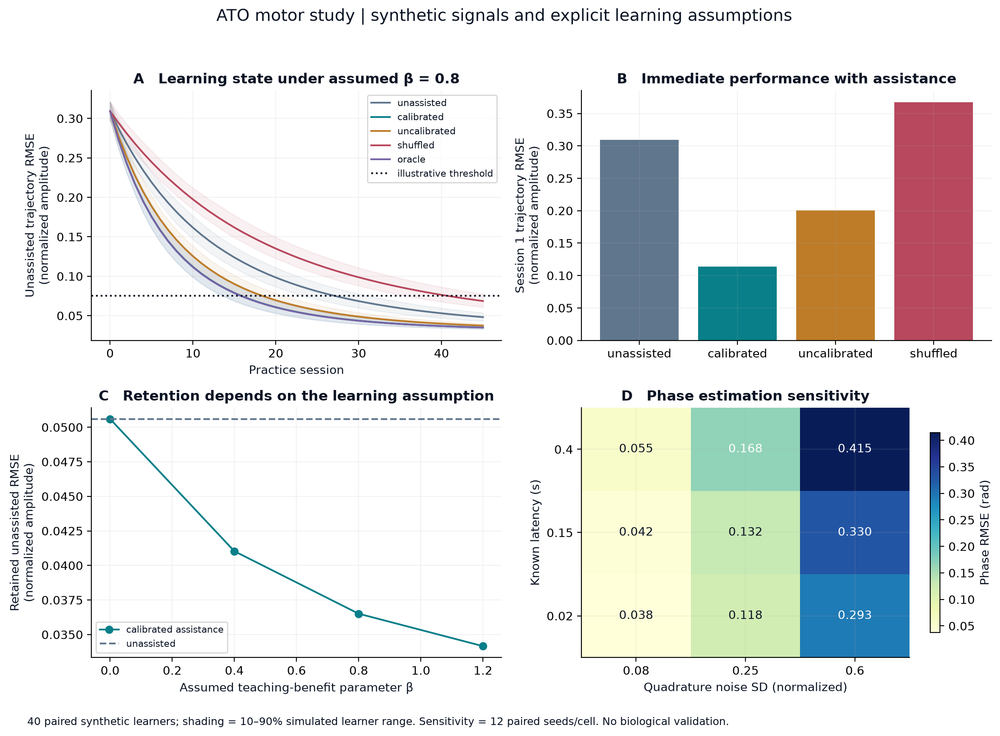
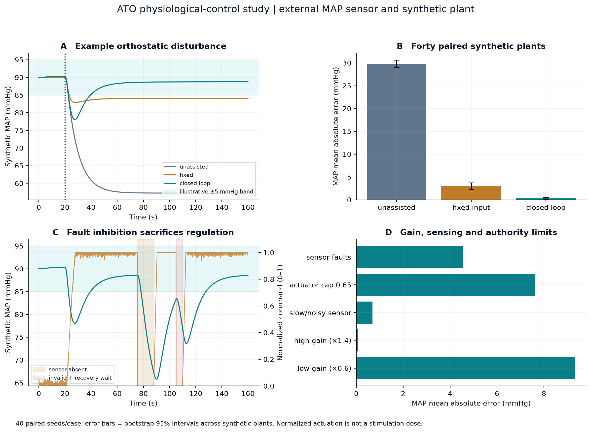
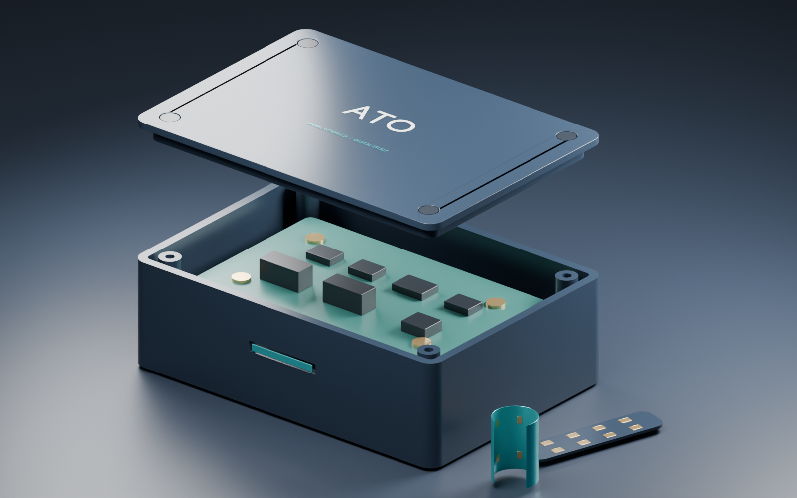

# Project ATO

**Invasive spinal recording, computational interpretation, personalized stimulation and feedback.**

ATO is an entirely digital research and engineering project with two ambitions:
expert-informed motor practice that improves retained unassisted performance,
and target-specific physiological automation. AstroSam's [Mind-Link](https://github.com/sam-astro/Mind-link)
inspires the progression from future vision to inspectable electronics and physical design.

> **Stages 1–5 are complete within their stated digital scopes.** The project
> now includes the conditional mechanism, preserved conservative studies, actual
> bounded target firmware, eight integrated routed PCB designs and independently
> inspected native mechanical assemblies. The integrated illustrated paper and
> reproducible final release follow in Stage 6.
> Biological efficacy and implant miniaturization remain conditional. Work is
> on `overhaul/full-scci-system`; video and website work are parked.



| Start here | What to review |
|---|---|
| [Stage 5 mechanical CAD package](cad/stage5/README.md) / [mechanical review sheets](cad/stage5/drawings/ATO_Stage5_Mechanical_Review.pdf) | True-scale eight-board reference chassis, combined 260-part native assembly and separate 36-port conditional future implanted interface; editable CAD, mounting/mating interfaces, STEP/STL and nominal fit evidence |
| [Conditional SCCI concept](docs/stage3/conditional-concept.md) / [assumption ledger](docs/stage3/conditional-concept/assumption-ledger.csv) | Current design baseline: defensible future-interface assumptions, both mechanisms and the electronics/CAD handoff |
| [New conditional scenario study](experiments/stage3/conditional-concept/README.md) | 128 scenarios: assistance can improve execution while retained learning improves, stays equal or worsens; no unique neural advantage claimed |
| [Stage 3 exit review](docs/stage3/exit-review.md) / [integrated verdict](docs/stage3/stage3-verdict.md) / [illustrated report](output/pdf/ATO_stage3_closeout.pdf) | Audited finite investigation and detailed-design handoff; actual assistance remains unavailable |
| [Final frozen-observer replay](experiments/stage3/frozen-observer-pilot/README.md) | 32 practice/64 OFF sessions; all interventions withheld; forecast sealing, guards and OFF behavior verified |
| [Latest Stage3 continuation](docs/stage3/continuation-review.md) | Numerical verification, fair input comparisons, teacher correction, response limits and next design work |
| [Current mechanism revision](docs/stage3/evidence-to-design-revision.md) | Paper-to-design reasoning, qualified teacher references, intervention-aware prediction and precision requirements |
| [Illustrated Stage 3 revision report](output/pdf/ATO_stage3_mechanism_revision.pdf) | Selected teacher, source, causal forecast, pulse-response and delivery-precision findings |
| [Connected reset-trial pilot](docs/stage3/isolated-pilot.md) | Qualified teacher references consumed; independent learner-drift forecasts reject all practice interventions; OFF results show no advantage |
| [Confirmed no-dose observer](experiments/stage3/observed-state-observer/README.md) | Frozen method, raw data and independent audits: all 32 fresh sensor-noise captures pass the finite 15 mm budget; stimulation and learning benefit remain unqualified |
| [Bounded integration plan](docs/stage3/observer-integration-plan.md) | Pre-dose forecast freeze, independent guards, one-shot permission and explicit delivery/learning-interaction limits |
| [Stage 4 native monitoring work](docs/stage4/entry-plan.md) / [editable KiCad slice](electronics/stage4/monitoring-cell/README.md) | Preserved initial slice: three reviewed sheets, 245 checked pins and zero ERC; now part of the integrated board set, with analog precision limits retained |
| [Native two-source current driver](electronics/stage4/current-driver/README.md) / [circuit and permission study](electronics/stage4/driver-study/README.md) | 156 components, 572 checked pins, five editable sheets and zero ERC violations; restricted 24 V/3 mA design, closed-servo model and sticky interruption/rearm logic |
| [Native sixteen-stream recording front end](electronics/stage4/recording-front-end/README.md) / [input and protocol studies](electronics/stage4/recording-study/README.md) | 151 components, 594 checked pins and seven editable sheets; protected inputs, shared reference, isolated SPI/control and grounding selection; timing revision and weak-signal/fault limits explicit |
| [Native contact router](electronics/stage4/contact-router/README.md) / [routing and parasitic studies](electronics/stage4/routing-study/README.md) | 155 components, 650 checked pins and six editable sheets; two sixteen-way selectors, held addresses, collision inhibit and fresh verification/rearm; actual switch position and terminal isolation remain unqualified |
| [Native independent shutdown and supervision](electronics/stage4/supervision/README.md) / [finite studies](electronics/stage4/supervision-study/README.md) / [integration design](docs/stage4/supervision-design.md) | 478 components, 1699 checked pins, 22 editable sheets and zero ERC; 18 terminal guards, independent phase timers/watchdog, observed current/voltage/rails/recording blank and deliberate rearm |
| [Native power and resource budgets](electronics/stage4/power/README.md) / [finite study](electronics/stage4/power-study/README.md) / [design consequences](docs/stage4/power-design.md) | 156 components, 449 checked pins, 15 sheets and zero ERC; nine generated rails, isolated AFE, reference-qualified shutdown; conditional 2.615 W / 5.886 h; compact thermal and inherited ADC/link failures retained |
| [Monitoring and companion interfaces](docs/stage4/monitoring-transport-design.md) / [native KiCad](electronics/stage4/monitoring-transport/README.md) / [finite studies](electronics/stage4/transport-study/README.md) | 60 components, 217 pins, eight sheets and zero ERC; dedicated 450k aggregate raw acquisition, shared charge endpoints, isolated UART, packet freshness and bounded diagnostics; revised conditional 2.800 W / 5.497 h |
| [Actual nRF5340 firmware](firmware/nrf5340/README.md) / [implementation review](docs/stage4/nrf5340-firmware-design.md) | Linked C/Zephyr application, shared production core with compiled fault tests, actual SPI/UART and timer/DPPI cutoff, active-route readback and explicit carrier dependency; lower-rate implemented profile and unmeasured timing remain explicit |
| [Integrated populated board set](electronics/stage4/integrated-pcb/BOARD_INDEX.md) / [Stage 4 exit review](docs/stage4/exit-review.md) | Eight routed native boards, 1,298 positions / 1,296 fitted, 80-sheet master, 258 harness connections, actual controller and populated STEP; zero native ERC/DRC/unconnected/parity/ignored findings; nominal geometry and unmeasured physical limits explicit |
| [Independent phase-charge study](electronics/stage4/monitoring-study/README.md) | 33 transient runs, both sources and 462 measured intervals in the behavioral model; bias, reset, settling and cancellation failures retained; 4% accuracy remains unearned |
| [Stage3 computational foundation](docs/stage3/README.md) | Causal contact observations, expert/learner mechanism, measured delivery and external-pressure feedback |
| [Stage3 results and remaining work](docs/stage3/results-and-interpretation.md) | Honest integrated abstention, conditional learning studies, pressure benefits and failures |
| [Free/student tool selection and inventory](docs/stage3/toolchain-selection.md) | Fresh CAD/EDA/numerical checks and justified optional tools |
| [Illustrated Stage 2 brief](output/pdf/ATO_stage2_architecture_budgets.pdf) | Eight-page quantitative architecture with scientific figures and physical allocations |
| [Stage 2 technical dossier](docs/stage2/README.md) | Selected design, source audits, control contracts and reproducible budgets |
| [Stage 2 completion review](docs/stage2/exit-review.md) | Twelve exit criteria, alignment with the main concept and explicit handoff limits |
| [Native preliminary CAD](cad/stage2/ATO_stage2_allocation.FCStd) | FreeCAD/STEP allocation assembly; 80 solids and 36 illustrative body ports |
| [Illustrated Stage 1 brief](output/pdf/ATO_stage1_system_specification.pdf) | Nine-page overview with the complete system and both causal mechanisms |
| [Full design dossier](docs/stage1/README.md) | Mechanisms, evidence audit, architecture alternatives and interface responsibilities |
| [Requirements](docs/stage1/requirements.csv) | 36 owned requirements linked to planned verification |
| [Assumptions and capability map](docs/stage1/assumptions.csv) | Explicit biological and engineering premises; [future applications](docs/stage1/capability-map.csv) |
| [Model and verification plan](docs/stage1/model-and-verification-plan.md) | Neural/external and expert/learner comparisons; later electronics and CAD checks |
| [Current status](CURRENT_STATUS.md) | Completed work, unresolved decisions and next bounded work package |
| [Overhaul programme](docs/overhaul-plan.md) | Six stages from mechanism to integrated technical manuscript and repository |

The proposed platform includes a recording/ADC chain, local interpretation and
output admission, programmable stimulation and contact routing, delivered-current/
charge/compliance monitoring, independent supervision, power, telemetry, companion
sensing and an offline expert representation/calibration environment. It has
target-specific configurations rather than one lead arrangement for all functions.

Stage 1 recommends lower-limb coordination and pressure regulation as first
quantitative reference cases. Cervical/piano, bladder, cough, selected pelvic
responses and bodily sensory applications remain in the capability map. Each
requires its own information and causal access. Expert transfer, retained healthy
learning and long-term consumer use are hypotheses, not results of this dossier.

Specification consistency is checked with `python scripts/verify_stage1_specification.py`.
The [Stage 1 receipt](provenance/stage1-verification.json) is separate from the
original release's engineering evidence. Stage 2 budgets are reproduced with
`python scripts/run_architecture_budgets.py --check` and audited with
`python scripts/verify_stage2_architecture.py`; see the
[Stage 2 receipt](provenance/stage2-verification.json) and
[scoped progress](docs/stage2/verification-progress.csv). Detailed circuits,
bounded target firmware and the integrated populated board set are now complete
within Stage 4's digital reference scope. Biological authority and implant
miniaturization remain conditional; mechanical packaging and the integrated
paper/release follow in Stages 5 and 6.

## Historical subsystem reference: v1.0.0

The earlier release remains available for its circuit workflow, desktop assembly,
portable sequencer and conditional surrogate studies. Its eight-contact display,
model gains and desktop enclosure do not define the new implant. Its manuscript,
results and verification receipts apply only to that historical scope.

<details>
<summary>Open the original v1.0.0 reference documentation</summary>

### A digital engineering study of invasive spinal interfaces

**Research · synthetic experiments · control logic · electronics · parametric CAD**

Project ATO asks how useful information recorded at spinal pathways could support
calibrated interventions for motor practice and physiological feedback. It connects
a future invasive interface concept to two reproducible computational studies and
a tangible digital engineering reference.

**Release 1.0 is entirely digital.** No human or animal signals were recorded and
no hardware was fabricated. The enclosure is a desktop demonstrator. The future
recording and stimulation leads are separate anatomical hypotheses. Simulated
improvement does not establish biological effectiveness.

| Start here | What it contains |
|---|---|
| [Engineering paper](output/pdf/ATO_engineering_paper.pdf) | Scientific foundations, equations, experiments, design reasoning and limitations |
| [Interactive walkthrough](site/index.html) | Local presentation with recorded traces and a timing calculator |
| [72-second video](media/ATO_walkthrough.mp4) | Captioned tour of the digital proof of concept |
| [Learning guide](docs/learning-guide.md) | Questions, derivations and demonstrations to understand before presenting |
| [Verification record](provenance/verification.json) | Checks actually executed for this release |

GitHub previews source HTML rather than running it. To explore the walkthrough,
clone/download the repository and serve it locally as described below.

## The engineering argument



The future platform proposes eight spinal recording contacts and eight stimulation
contacts, with task-specific placement and optional external measurements. ATO
does not require brain recording. Intradural surface recording and epidural
stimulation are distinct access routes; long-term integration is unverified.

The reference circuit implements **one artificial-signal acquisition channel and
one dummy-load output channel**. It has no populated ADC or MCU. The portable C
module and application adapter demonstrate timing and fault handling on a host,
rather than firmware flashed onto an implanted system. The quadrature estimator,
reference circuit and future implant operate at different abstraction levels.

## Two application studies

### A. Expert-informed rhythmic practice

The expert supplies task structure, not a voltage waveform to replay into a
learner. A calibrated policy estimates a synthetic rhythm and assists an individual
response. Online performance and unassisted retention are scored separately.

- Forty paired synthetic learners compare unassisted, calibrated, uncalibrated,
  shuffled and oracle policies.
- With an **assumed** learning-benefit parameter β = 0.8, retained model RMSE falls
  by 27.61% and threshold acquisition has a conditional mean speed ratio of 1.685.
- With β = 0, the retained advantage is **exactly zero**, despite active assistance.
- Incorrect latency assumptions and shuffled timing can harm the model's learning.

These numerical results are conditional consequences of the chosen model. The
plasticity benefit is prescribed, not discovered or measured in people. Bootstrap
intervals represent simulation variability only.



### B. Mean arterial pressure feedback

A reduced-order synthetic plant represents an orthostatic disturbance after SCI.
An external pressure observation drives a bounded feedback policy with actuator
saturation, rate limits, anti-windup and freshness gating.

- Forty paired trials compare no intervention, fixed input and closed-loop control.
- Nominal closed-loop MAE is 0.31 mmHg versus 29.83 mmHg unassisted in the specified
  **post-transient** scoring window. The initial pressure dip remains visible.
- Weak actuator gain, output limits and sensor faults reduce regulation.
- No nonzero application commands occur during the model's stale-sensor state.

The normalized pressor command is not a human stimulation dose. Clinical evidence
motivates the application, while the numerical plant is an inspectable abstraction.



## Electronics and physical identity



- **Electronics:** native KiCad schematic and routed 80 × 50 mm PCB, component BOM,
  local libraries, Gerbers, drill files, STEP and exported schematic. A regulated
  sink and switch network reverse the nominal 100 μA dummy-load current.
- **Electrical evidence:** analytical and generic-device ngspice models, including
  non-ideal RC polarization, compliance failure and switching transients. A discovered
  transition-current problem prompted a documented passive-limiting revision.
- **Protocol:** compiled C state machine, PHASE/INHIBIT adapter, sensor freshness,
  nominal 200 μs phases and 20 nC ideal charge per phase. Analog behaviour is checked
  separately from ideal digital scheduling.
- **Mechanics:** 100 × 70 × 32 mm desktop enclosure, matching mounting pattern,
  separate eight-contact surface-cuff and paddle visualizations, parametric source,
  STEP/STL, native FreeCAD assembly and editable Blender presentation scenes.

The series resistors limit current under specified supply/load/polarization
conditions; they are not a universal tissue-safety clamp. Switch charge injection,
device models, stored polarization, current monitoring and hardware shutdown need
further verification. Read [the circuit analysis](docs/electronics.md) and its
failure cases before interpreting a nominal waveform.

## Reproduce the digital studies

Use Python 3.12 or 3.13 and a C11 compiler (GCC, Clang or Zig). The checked-in
outputs are usable without CAD tools. Exact tested versions are recorded in
[the environment record](provenance/environment.json).

```sh
python -m venv .venv
# Activate .venv using the command appropriate for your shell.
python -m pip install -r requirements.txt
python scripts/verify_manifest.py
python scripts/run_studies.py
python scripts/build_firmware.py
python scripts/run_adapter.py
python -m unittest discover -s tests -v
python scripts/check_release.py
```

The firmware builder accepts `--cc /path/to/compiler` when the compiler is not
on PATH. Builds go into ignored `build/`. All study seeds, equations, units,
scoring exclusions and censoring rules are in [model methods](docs/model-methods.md).

To open the presentation:

```sh
python -m http.server 8000 --bind 127.0.0.1
# Open http://127.0.0.1:8000/site/index.html
```

To regenerate other assets:

```sh
python -m pip install -r requirements-cad.txt
python cad/build_ato.py
python scripts/draw_architecture.py
python scripts/draw_mechanical.py
blender --background --factory-startup --python cad/render_ato.py
python scripts/build_paper.py
python scripts/build_site.py
python -m pip install -r requirements-media.txt
python scripts/build_video.py
```

KiCad/FreeCAD/ngspice rebuilding uses their supplied scripting interfaces; see
[electronics instructions](electronics/README.md), [mechanical notes](cad/README.md)
and the respective build scripts. Circuit and CAD tools are separate optional
dependencies from the Python study environment. Browser UI and PDF layout checks
are documented rather than replaced by claims of full automated validation.

## Repository map

```text
docs/           Paper source, evidence, claims, methods and learning guide
src/ato/        Synthetic motor/pressure models and compiled-C binding
firmware/       Portable pulse logic and host validation
electronics/    Native KiCad designs, BOM, local libraries and manufacturing exports
cad/            Parametric geometry, STEP/STL, FreeCAD and Blender scenes
results/        Seeded raw trials, sweeps, traces and validation receipts
figures/        Scientific figures in raster and vector formats
media/          Rendered views and captioned walkthrough video
site/           Local interactive presentation
output/pdf/     Engineering paper
scripts/        Reproduction, rendering and verification entry points
tests/          Meaningful model and compiled-C tests
provenance/     Contributions, environment, verification and hashes
```

## Evidence, credit and scope

Primary starting points include [surface spinal recording in rodents (2026)](https://doi.org/10.1038/s41467-026-75128-z)
and [implantable hemodynamic regulation after SCI (2025)](https://doi.org/10.1038/s41591-025-03614-w).
Their scope and limits are recorded in [the evidence matrix](docs/evidence-matrix.csv).
The supplied hypothesis paper was audited as a reference; its five-rat description
is corrected to 15 rats overall with a five-rat motor-decoding subset.

**AstroSam's [Mind-Link](https://github.com/sam-astro/Mind-link) and
[video](https://www.youtube.com/watch?v=5YxrpcqkTYA) inspired the project format.**
ATO develops its own spinal architecture, code, circuit and geometry. It does not
claim invention of spinal interfaces or reuse Mind-Link design files.

Created for **Pratham Varma with extensive AI assistance**. Contributions are
disclosed in [provenance](provenance/CONTRIBUTIONS.md). This private portfolio is
not affiliated with any university and does not certify a degree-level assessment.
Biological validation, chronic implant engineering and physical hardware testing
remain outside this entirely digital release.

</details>
