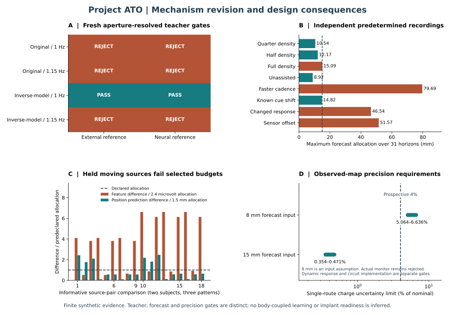

# Intervention-aware prediction: specification and measured digital results

9 October 2026. This is a new conditional mechanism experiment. Historical
motor, cue and acquisition receipts remain unchanged. No positive result is
required and no biological parameter is changed to obtain one.

## Allocations fixed before the new results

The experiment retains 200 Hz decisions, 40 Hz complete fixed profiles, the
midpoint exact-cascade body solver at 2.5 ms, 35 ms private onset, and the existing
3 mA / 200 microsecond / 24 V illustrative profile. These are digital inputs.
The new observer predicts every 5 ms horizon from zero through **150 ms**.
The forecast allocation remains **15 mm**, the correction allocation **25 mm**,
and the chosen measured-label allowance **3 mm**. Purged chronological fitting
uses 100 ms on each side of its split. Allocation values are not physiological
tolerances or statistical confidence bounds.

The prospective delivery premise remains **1.012 nominal with 0.074 nominal
uncertainty**, always `UNQUALIFIED_NOMINAL_ASSUMPTION`. Future commands are
known predetermined instructions; they are never future monitored charge.
Past monitor evidence becomes available only after a complete 500 microsecond
biphasic drive (two 200 microsecond phases plus the existing 100 microsecond gap).
Acquisition uses `bounded_residual` and 20 microsecond clock uncertainty.
Invalid spinal packets stay invalid. External observation delay remains 20 ms.

## Observable model and independent recordings

Inputs contain sixteen past measured two-position samples, known current/future
task instructions, and a 5 ms dose-history grid from 300 ms before the latest
position support through its prediction target. Past dose uses monitor records
available at the decision. Remaining intervals use only the predetermined
command schedule and the explicitly assumed dose interval. No future measured
position, measured charge, private movement phase, recruitment, gain, activation
or skill coefficient is an online input. Offline future measured positions are
training/evaluation labels only.

Four six-second nominal-subject training recordings use predetermined whole-pulse
patterns at full, half, quarter and mixed density. Individual signed routes,
same-sign mixed routes, opposed routes and no-output intervals are included.
Each recording has its own observation-noise identity. The last chronological
portion is purged and withheld. A ridge direct predictor is fitted independently
at all 31 horizons. Its dose-input intervals are propagated through its fitted
linear weights; that arithmetic is conditional on the fitted model. Empirical
heldout residuals do not establish a universal model-error enclosure.

Complete new six-second recordings then test quarter, half and full density,
unassisted motion, 15% faster known cadence, a known task-time shift, a separately
identified changed response context and an unannounced sensor-offset step.
Every context is checked at every requested horizon. Failed, absent or
out-of-domain contexts must abstain. A pass applies only to the identified finite
recording, instruction and intervention domain.

## Coupling gate

The existing actual electrical monitor still supplies the negative-authority
control. A prospective conditional map cannot qualify that adapter. A correction
must retain the full map/dose expression
`U_G |u| + |G| U_u + U_G U_u`, in addition to prediction uncertainty.
Resting steady-state route validation does not automatically qualify a dynamic
execution-time correction. A feedback-dependent command sequence is a new
domain; successful predetermined recordings do not silently authorize it.

Only a separately qualified dynamic correction, valid execution support,
qualified teacher representation and fresh acquisition/electrical/frame guards
can earn a coupled assisted witness. Otherwise this experiment ends with a
tested observer and an explicit abstention receipt, not a learning claim.

## Results of the frozen experiment

All 31 horizons pass the chronological calibration gates. There are 3,300 fitting
and 940 purged holdout rows per horizon, drawn from the four calibration recordings.
Eight complete withheld recordings give **248 independent recording/horizon
checks**. Every row in each complete recording contributes to its finite gate;
failed horizons are not omitted or refitted.

| Complete withheld recording | Maximum allocation over all horizons | Finite context gate |
|---|---:|---|
| Quarter density | 10.539 mm | Pass |
| Half density | 12.175 mm | Pass |
| Full density | 15.086 mm | Reject |
| Unassisted | 8.925 mm | Pass |
| Known 15% faster cadence | 79.689 mm | Reject |
| Known 125 ms cue shift | 14.817 mm | Pass |
| Changed response | 46.540 mm | Reject |
| Unannounced 40 mm sensor offset | 51.571 mm | Reject |

The full-density failure is retained even though it misses the unchanged 15 mm
allocation narrowly. The new model improves selected predetermined assisted
contexts relative to the [older cue component](cue-policy.md). It does not grant
admission to an arbitrary feedback-dependent command sequence. All actual and
prospective coupling audits still reject dynamic execution, with **zero coupled
feedback pulses** and no retained-learning measurement.

Qualified runtime calls match the known instruction, complete required command
coverage, finite schedule and physical support domain. They also propagate the
**current** dose uncertainty, not just the dose mean. The live component allowance
is the maximum of the saved training/context total allocations and the larger
saved residual plus the label allowance plus current dose projection. This
retains the saved gates without adding their already included dose maxima twice.
An enlarged interval rejects even when the feature values and prediction stay
unchanged. The [dynamic coupling specification](dynamic-coupling-specification.md)
records this arithmetic and the next execution-time response tests.

The forecaster uses external measurements; invalid spinal packets stay invalid.
Its generated recordings retain the declared historical block-start source
approximation because neural features are not predictor inputs. The separately
[aperture-resolved teacher captures](resolved-teacher.md) do not silently qualify
that approximation or establish neural incremental value here.

Review the [raw model, measurements and predictions](../../results/stage3/assisted-prediction/raw.json.gz)
or [readable record](../../results/stage3/assisted-prediction/summary.json).
Recompute with:

```text
python scripts/stage3_assisted_prediction_study.py --check results/stage3/assisted-prediction/raw.json.gz
```


