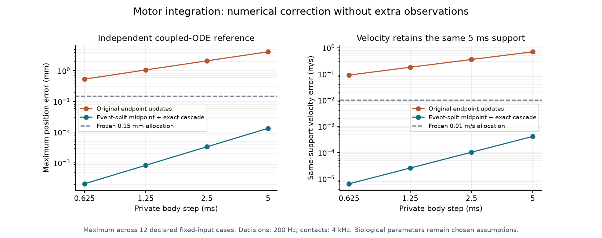
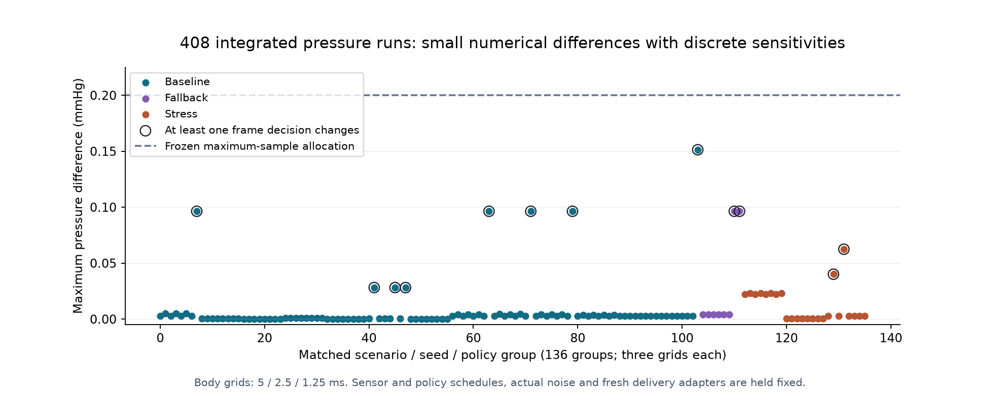

# Numerical verification and the next motor solver

8 October 2026. The [original convergence plan](numerical-convergence-plan.md)
defined error allocations before these outcomes. Results verify numerical
implementation under declared artificial mechanisms; they do not validate
spinal information, biological recruitment or human learning.

## Preserve the experiment while refining the body

Motor decisions remain at 200 Hz, with one 20-sample block per contact at 4 kHz.
Body integration has its own clock. External observations retain their original
support/availability; task, calibration, expert resource, pulse frames and
practice/assessment durations remain fixed. Noise receipts bind actual draws,
generator states, counts and physical observation schedules across grids.

Timestamped input changes split private body steps at their physical delayed
onset. Source velocity remains the displacement over the same 5 ms support,
rather than the last fine substep. Learning increments use the actual substep
duration. No refinement grants the controller additional information.

The original `legacy_endpoint` 5 ms path reproduces the frozen checkpoint's
world states exactly. Its capture comparison loads the frozen motor source with
the current default acquisition implementation, so it specifically checks the
motor refactor rather than a complete frozen acquisition reconstruction. The
entire historical foundation batch is also reproduced separately under unchanged
defaults. Preserving an old output does not establish its numerical accuracy.

## Motor: a defect found and a solver selected for further studies

The declared coupled differential equations were independently integrated with
event-split DOP853. An independent closed-form rest cascade checks that reference.
Twelve fixed-input cases cover rest/movement, nominal/fast/slow/nonaligned onset,
zero authority and adverse route response. Both integration methods run at
5 / 2.5 / 1.25 / 0.625 ms body steps.

The original update applies endpoint forcing and newly updated activation across
the preceding interval. Its maximum position error is approximately 4.13 mm at
5 ms and remains approximately 0.53 mm at 0.625 ms, exceeding the frozen 0.15 mm
allocation. Direction changes expose additional endpoint forcing error.

The new event-split method uses midpoint forcing/plasticity and the exact
constant-input activation-to-position cascade. At 5 ms its worst fixed-input
position error is approximately 13.35 micrometres; at 2.5 ms approximately
3.34 micrometres. These cases meet the frozen position, coefficient and
same-support velocity allocations. A separate independent ODE test checks all
four plasticity laws under a one-second mixed input.



A bounded closed-loop experiment preserves actual noise across five solver/grid
conditions. It uses one subject, favorable and zero laws, two arms, one three-
second practice block, and OFF retention/transfer. Comparing midpoint 2.5 ms
against midpoint 0.625 ms gives:

| Compared quantity | Maximum difference | Frozen allocation |
|---|---:|---:|
| Position component | 3.55 micrometres | 150 micrometres |
| Trajectory RMSE | 1.93 micrometres | 100 micrometres |
| Final learning coefficient | 0.023 micrometres | 100 micrometres |
| Same-support velocity | 0.0000984 m/s | 0.01 m/s |
| Contact timing RMSE | 0 | 1 ms |

Pulse events, policy reasons, qualification, retained-benefit sign, zero-law null
and acquisition censoring are stable in this selected comparison. The 5 ms
midpoint run retains one marginal reason change. Subsequent new studies therefore
**explicitly select midpoint 2.5 ms**; the default historical path is retained.
This selection is verified in the stated bounded scope, not across every
controller, subject or structural family.

The original coarse controller and converged controller can make different
discrete decisions: the selected assumed-delivery assisted run changes from 57
to 42 pulses, with 227 reason differences and up to approximately 25.0 mm
trajectory difference. The original conditional learning numbers are consequently
preliminary. They must not be presented as stable quantitative benefit estimates.

## Pressure: full declared matrix with sensitivities retained

The pressure study evaluates 408 integrated runs: 312 baseline runs covering
13 scenarios, four seeds and feedback/OFF at three grids; 24 extra finite-hold/
ramp fallback runs; and 72 separately declared nonaligned/near-limit stress runs.
Each run begins with a fresh electrical delivery adapter. Sensor sampling,
extraction and policy remain 200 Hz / 1 Hz / 4 Hz; actual noise and observation
support/transport schedules match across grids. Oracle results are excluded.

| Quantity | Maximum observed difference | Frozen allocation |
|---|---:|---:|
| Pressure at policy support | 0.15133 mmHg | 0.2 mmHg |
| Pressure summary metric | 0.01889 mmHg | 0.2 mmHg |
| Delivered train equivalent | 0.075 s | 0.5 s |
| Fallback duration | 0 s | 0.25 s |

All numerical allocations pass. **Twenty-four comparison-level frame
sensitivities across twelve groups remain reported.** Qualification, gain sign,
controller reason, extracted peak timing and fitted lag remain stable. Meeting a
continuous numerical-error budget does not make frame admission invariant.



The 104 coarse baseline witnesses exactly preserve the earlier saved OFF and
feedback results. Nonaligned onset, release expiry and context changes select an
explicit timestamped event path. The baseline's aligned legacy path is not
silently reinterpreted as that new path. An independent analytic fixed-input
cascade supplies an additional reference.

## Reproduce and inspect

```text
python scripts/stage3_motor_convergence.py --check results/stage3/numerical/motor-convergence.json.gz
python scripts/stage3_pressure_convergence.py --check results/stage3/numerical/pressure-convergence.json.gz --summary-check results/stage3/numerical/pressure-convergence-summary.json --jobs 2
python scripts/stage3_acquisition_qualification.py --check results/stage3/numerical/acquisition-qualification.json.gz
```

Motor reproduction also needs the frozen Git object `526b854`; the CI checkout
retains history for this check. A missing object is not accepted as successful
baseline preservation. Raw witnesses are deterministic gzip JSON; readable
[motor](../../results/stage3/numerical/motor-convergence-summary.json) and
[pressure](../../results/stage3/numerical/pressure-convergence-summary.json)
summaries retain scope, all comparisons and source identities.

[Acquisition qualification](acquisition-qualification.md) separately studies
range-bounded digital filter contamination and an analytic aperture source. It
does not convert body convergence into physical amplifier recovery, nor complete
the moving-body per-aperture approximation study. New learned observers, cue
policies and response-context changes require their own validation. Continuous
microsecond routing, independent guards and power remain Stage 4 integration.
