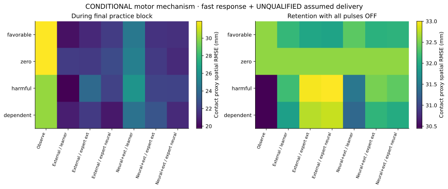
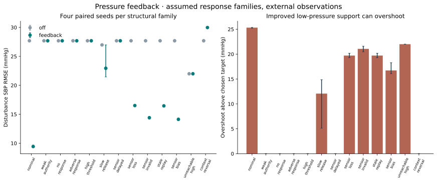
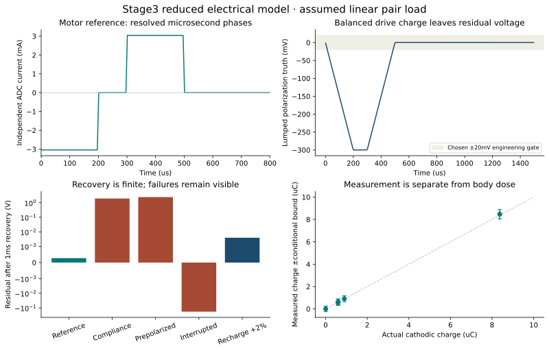

# Stage3 results and interpretation

> **Foundation results at the frozen coarse reference.** Subsequent [numerical verification](numerical-verification.md) found material motor discretization and closed-loop decision differences. These original conditional motor numbers remain reproducible but are preliminary, rather than stable quantitative benefit estimates. New comparisons use an explicitly selected solver and acquisition qualification; see the Stage 3 dossier for the continuation results. The pressure refinement findings retain all reported frame sensitivities.

8 October 2026. These are reproducible artificial model results, not human or implanted-device measurements.
Stage3 remains **in progress**. Negative integrated outcomes and conditional biological investigations have different evidence scopes.

## Study scope

The pressure batch contains 156 runs:13 structural families ×4 paired seeds ×3 modes. Off and feedback share calibration; oracle uses hidden information solely as a labeled diagnostic. Eight additional finite-hold/ramp sensor-loss runs supplement the stop cases.
The motor batch contains 12 configuration/seed studies, each with4 plasticity families and7 comparison arms. It separates nominal electrical integration, faster-response electrical sensitivity, and conditional fast response with an explicitly unqualified assumed delivery model. Six negative-control witnesses run at seed0 in each branch.

All four-seed ranges below describe Monte Carlo variation **within chosen assumptions**; they are not confidence intervals for biology.

## Motor: identify the bottleneck before claiming a learning effect

| Branch | Seed | Observed onset (ms) | Dose bound / measured charge (%) | Local map qualified | Practice pulses across arms/families |
|---|---:|---:|---:|---|---:|
| nominal | 0 | 70.00 | 43.54 | False | 0 |
| nominal | 1 | 70.00 | 43.54 | False | 0 |
| nominal | 2 | 67.50 | 43.54 | False | 0 |
| nominal | 3 | 70.00 | 43.54 | False | 0 |
| fast_response_sensitivity | 0 | 37.50 | 43.54 | False | 0 |
| fast_response_sensitivity | 1 | 40.00 | 43.54 | False | 0 |
| fast_response_sensitivity | 2 | 35.00 | 43.54 | False | 0 |
| fast_response_sensitivity | 3 | 37.50 | 43.54 | False | 0 |
| conditional_fast_response_assumed_delivery | 0 | 37.50 | 7.31 | True | 5346 |
| conditional_fast_response_assumed_delivery | 1 | 40.00 | 7.31 | True | 4723 |
| conditional_fast_response_assumed_delivery | 2 | 35.00 | 7.31 | True | 4996 |
| conditional_fast_response_assumed_delivery | 3 | 37.50 | 7.31 | True | 4821 |

The nominal reactive controller must include physical observation age,11.85ms processing allocation, measured response onset and onset uncertainty. A request that exceeds the100ms chosen horizon is withheld. The conservative independent charge bound also widens response-map uncertainty; its authority gate may abstain even in a faster-response plant.

When an arm emits no assistance, equal outcomes do not establish that neural or expert information has no value. They show that the chosen integrated policy failed to earn an intervention. The conditional branch investigates what the mechanism could do if future timing and delivery identification meet tighter assumptions. It does not demonstrate that the current electrical design supplies them.

Each artificial plasticity family has separate assisted practice, OFF retention and OFF transfer. The zero-coupling family can have online assistance without additional retained learning. No acquisition multiplier is inserted or claimed. Artificial thresholds that are not reached are censored, not scored as a speed-up.

The motor figure averages four paired seeds. Each panel has its own color scale; lower RMSE is better. OFF assessment begins with movement and activation reset to zero and a chosen 2% forgetting factor. This idealized post-washout comparison does not simulate physiological withdrawal or a specified human retention interval.

## Pressure: benefits and failures are both outcomes

| Structural family | Feedback disturbance RMSE mean [range] (mmHg) | Off mean (mmHg) | Feedback overshoot mean [range] (mmHg) | Qualified calibration /4 |
|---|---:|---:|---:|---:|
| nominal | 9.43 [9.24–9.68] | 27.70 | 25.33 [25.24–25.36] | 4 |
| weak_authority | 27.70 [27.70–27.70] | 27.70 | 0.00 [0.00–0.00] | 0 |
| no_response | 27.70 [27.70–27.70] | 27.70 | 0.00 [0.00–0.00] | 0 |
| adverse_response | 27.70 [27.70–27.70] | 27.70 | 0.00 [0.00–0.00] | 0 |
| high_threshold | 27.70 [27.70–27.70] | 27.70 | 0.00 [0.00–0.00] | 0 |
| slow_release | 22.95 [21.45–26.98] | 26.98 | 12.07 [5.14–14.85] | 3 |
| sensor_delayed | 27.70 [27.70–27.70] | 27.70 | 0.00 [0.00–0.00] | 0 |
| sensor_loss | 16.51 [16.33–16.66] | 27.70 | 19.71 [19.28–20.18] | 4 |
| sensor_invalid | 14.41 [14.20–14.62] | 27.70 | 21.06 [20.47–21.60] | 4 |
| stale_replay | 16.45 [16.31–16.66] | 27.70 | 19.71 [19.28–20.18] | 4 |
| sensor_bias | 14.13 [13.95–14.34] | 27.70 | 16.73 [16.06–18.28] | 4 |
| unreachable_high | 22.00 [22.00–22.00] | 22.00 | 22.00 [22.00–22.00] | 4 |
| context_reversal | 29.98 [29.93–30.05] | 27.70 | 0.00 [0.00–0.00] | 4 |

Dense stimulation does not qualify a neural pressure decoder. External waveform support, peak time and arrival remain distinct; new arrival cannot refresh an old bodily measurement. Nonnegative pressor drive cannot independently lower a high baseline. No/adverse response and stale calibration can prevent qualification; subsequent context reversal can invalidate previously identified authority.

A finite fallback may preserve support briefly or withdraw it. None is labeled universally safe. Recovery overshoot remains visible after current is reduced because the assumed response has activation and release dynamics.

| Sensor-loss fallback | Fallback nadir mean [range] (mmHg) | Mean full-train equivalent delivered during fallback (s) |
|---|---:|---:|
| stop | 92.15 [92.12–92.16] | 0.000 |
| finite_hold | 92.20 [92.15–92.22] | 1.217 |
| ramp | 92.16 [92.15–92.17] | 1.015 |

These four-seed fallback comparisons reuse the same sensor-loss scenario. Longer support is a modeled tradeoff, not a safety ranking.

## Electrical evidence and the next engineering decisions

Event-aligned analytical load integration agrees with independent ngspice on the scoped linear cases, and an independent numerical ODE comparison checks compliance transitions. The current ADC estimates charge; it is not a copy of commands. Both phases have separate conservative bounds. A post-delivery failure preserves past body dose and latches subsequent source admission.

The next Stage3 work should resolve a feasible observed-data motor policy and calibration domain: examine per-profile response identification with independent delivery evidence, known-cue prediction within explicit uncertainty, and which monitor/guard precision Stage4 must earn. It should also complete motor numerical convergence, broader expert/source studies and joint structural sensitivity. This is a requirement-driven revision, not a reason to substitute desired outcomes.

Continuous shared-source routing, full power/transient coupling, actual independent guards, electrode chemistry, tissue-field recruitment, anatomy and chronic operation remain later or separate evidence. Complete KiCad and populated CAD are not claimed by these studies.

Reproduce with `scripts/run_stage3_studies.py`; raw JSON gzip files and readable summaries are in [results/stage3](../../results/stage3/). Review [verification-progress.csv](verification-progress.csv) for precise remaining scope.
