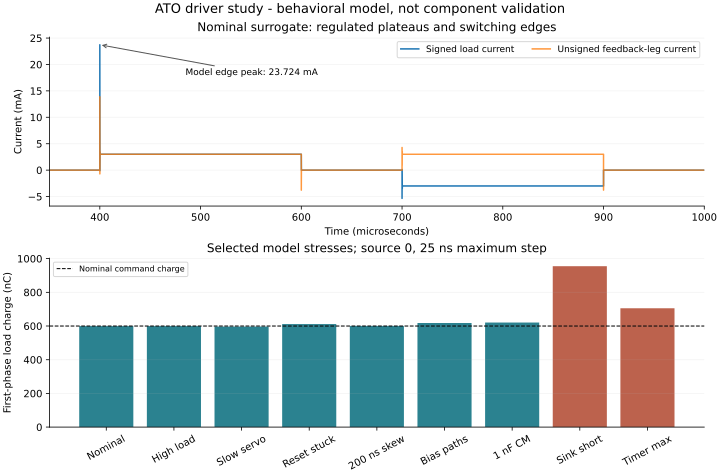
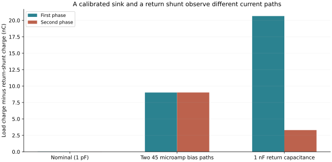

# Restricted current-driver circuit and permission study

**13 October 2026. Finite digital investigation complete within its declared
model scope: 20 attempted transients, 18 complete and two retained partial
out-of-compliance traces.** This is the companion study to the
[156-component native KiCad driver](../current-driver/README.md). The circuit
model instantiates a closed current servo and two polarity bridges; it does not
replace the native components with an ideal imposed load current.

The complete project remains a future implanted spinal recording, interpretation,
personalized stimulation and feedback platform under
[explicit biological premises](../../../docs/stage3/conditional-concept.md).
This electrical package supplies a concrete implementation investigation. It
does not establish tissue recruitment, learning or physiological efficacy.

## What the model contains

Two independent feedback-controlled sinks share ideal 24 V supply and DAC
setpoints. Each sink has a finite-gain, bandwidth/slew/rail-limited **behavioral
amplifier**, a chosen level-1 MOSFET, gate and feedback reset switches, a four-
switch polarity bridge, 100 ohm feedback resistor, and separate 2 ohm signed
return shunt. The load has series resistance, polarization capacitance and
leakage. Bias-current and common-mode capacitance paths remain explicit.

The amplifier is not TI's OPA192 macro model; the MOSFET is not Infineon's BSP89
model. Constants approximating component behavior and other chosen stresses are
listed in [sources-and-assumptions.json](sources-and-assumptions.json). The
model uses assumed valid supply rails and fixture switch waveforms; it is not
an automatically transformed simulation of every part in the five-sheet native
schematic. Propagation, switch injection, electrochemistry, full power conversion,
thermal SOA, the sixteen-contact router and native monitoring electronics remain
separate work.

Both sources run on 100 ns and 25 ns maximum solver steps; raw adaptive samples
are retained. There are 144 independently recomputed first/gap/second/whole-
profile intervals for the 18 complete transients. Two partial traces are never
assigned complete phase metrics. The compressed data occupy about 72 MB.

## Selected outcomes

Source 0 at the finer grid; source 1 remains in the complete saved results:

| Scenario | First load charge | Meaning within the chosen model |
|---|---:|---|
| Nominal | 599.791 nC | Settled feedback is about 3 mA, but switching is not an ideal rectangular current. Peak load current is 23.724 mA during an edge. |
| 2 kohm, 0.5 microF, initial 1 V | 599.717 nC | The selected high-load case remains within restricted modeled authority. This is not all-load qualification. |
| Slow servo stress | 596.775 nC | Finite response changes charge despite the same nominal command. |
| Feedback reset stuck active | 611.411 nC | Off-state windup alters the following phase. Grounding the gate alone is insufficient. |
| Feedback switches 200 ns early | 600.468 nC | Gate/reset ordering matters; this is one chosen skew witness. |
| Both monitor inputs draw 45 microA | 617.791 nC | Load current and unsigned feedback-leg current differ. First-phase load-minus-shunt charge is 9.021 nC. |
| 1 nF return-to-ground capacitance | 620.409 nC | Common-mode charging adds a path outside the feedback resistor; first-phase load-minus-shunt difference is 20.661 nC. |
| Sink short, 500 ohm load; fixture inhibits after 25 microseconds | 954.958 nC | Fault charge already exceeds the 600 nC target before the assumed interruption. Peak load current is 46.983 mA. Inhibit timing is injected, not measured from a real guard. |
| Healthy timer's maximum phase window | 705.260 nC | A duration backstop prevents indefinite output under its health assumptions; it does not enforce the nominal 600 nC target. |
| Forced 10 kohm load, outside compliance | No complete metric | Both solver runs stop near the first phase end. Full-profile behavior is numerically unqualified. Independently, 3 mA x 10 kohm = 30 V already exceeds the 24 V supply, so this load cannot be admitted at the requested current. |

The incomplete stress is an explicit boundary, not a result removed to obtain a
passing set. Its circuits and partial arrays remain in the package. No further
general model family is needed to hand this selected design to the next stage.



The normal waveform reverses **load current** while sink feedback remains
unsigned. Reversal of electrical phase does not imply an opposite biological
movement; task directions still require learner-specific recruitment programs.

## Independent charge-path check

At the return node the model obeys

`Iload = Ishunt + Ibias_load + Ccommon * dVreturn/dt`.

The verifier integrates the raw currents and independently checks

`Qload - Qshunt = Ibias_load * interval + Ccommon * Delta Vreturn`.

Maximum conservation residual is 0.001666 nC, below the declared 0.02 nC
numerical budget. Maximum charge difference between the selected solver grids
is 0.000506 nC, below the 0.2 nC numerical budget. These are equation/numerical
checks, not claims of sensor precision. A separate scalar MOS/opamp DC equilibrium
agrees with the nominal settled current within the chosen 2 microamp comparison
allowance.



Near-zero final bipolar charge does not certify either phase. Here the nominal
first and second charges nearly cancel despite a large edge peak, and fault or
bypass paths can change individual phases without appearing in the same way at
the driver feedback resistor. The existing monitor's prospective 4% accuracy
target remains unearned.

## Native permission contract and finite digital histories

The [control contract](../../../docs/stage4/current-driver-control-contract.md)
supersedes the earlier simple combinational RUN equation. Raw REQUEST triggers
the dedicated non-retriggerable timer. Sticky BLOCK/TIMEOUT state prevents
permission recovery or a repeated request from reopening an interrupted phase.
Safe rearm requires request/timer low, external health and observed quiescence.
Direction captures at safe rearm, before request, so the bridge does not
commutate from a live direction change.

[control-contract-results.json](control-contract-results.json) retains 15 finite
scenario groups, 27 source histories, 60 assertions and 187 state snapshots.
The 32 stable asynchronous-control combinations contain no simultaneous preset/
clear assertion. The separate native verifier also evaluates actual exported
gate connections and package-specific pins; neither check measures physical
setup/hold, logic hazards, analog brownout behavior or real shutdown latency.

A healthy nominal timer removes RUN after 225.024 microseconds of a stuck-high
request. An injected timer-stuck-high condition remains **unprotected without
external interruption**. The manufacturer's SET-open behavior motivates this
failure boundary; the study does not claim to simulate the internal failure of
the actual timer. The independent external watchdog is still required.

## Inspect and reproduce

| Artifact | Purpose |
|---|---|
| [study.py](study.py), [netlists/](netlists/) | Editable analog surrogate and every generated circuit |
| [results.json](results.json), [interval-results.csv](interval-results.csv) | All attempted-run identities, complete interval outcomes and explicit partial traces |
| [traces/](traces/) | All solver vectors, including both incomplete runs |
| [control_contract_study.py](control_contract_study.py) | Deterministic ideal-event histories and counterexamples |
| [verify_study.py](verify_study.py), [verification.json](verification.json) | Read-only raw-data, KCL, DC, grid and artifact checks |
| [Component review](../../../docs/stage4/current-driver-component-review.md) | Primary datasheet facts, corrected DAC setting and actual package/power limits |

From the repository root:

```text
python electronics/stage4/driver-study/verify_study.py
python electronics/stage4/driver-study/control_contract_study.py --check
```

No simulator or GUI is required for the saved-data checks. Deliberate local
regeneration uses `study.py --run` with the installed ngspice library, then
`build_figures.py`; review changes before refreshing the receipt. Regeneration
does not automatically refresh the derived CSV or the review receipt. The model
uses the existing monitoring study's unchanged shared-library adapter, whose
source identity is recorded. No simulator binary or vendor macro model is
redistributed.

The first native driver and monitor remain separate packages. Next reconcile
the actual load/shunt/guard paths, complete acquisition/protection, qualified
supervision, routing/power/firmware and a populated PCB/CAD assembly. The two
behavioural studies are engineering inputs to that work, not finished hardware.
