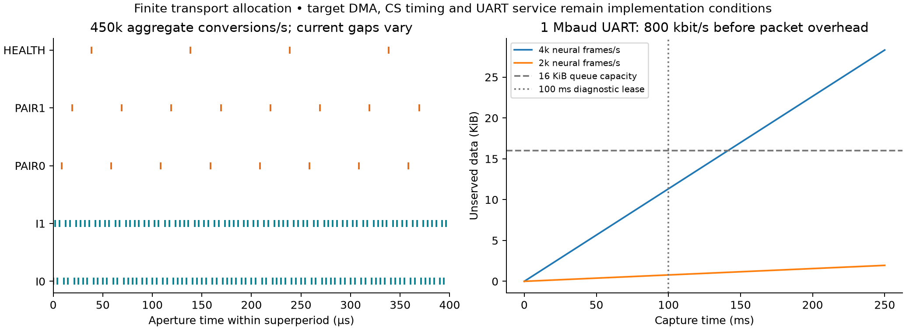
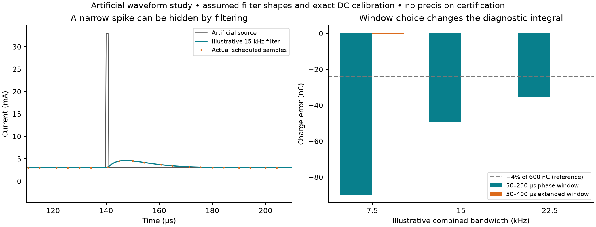
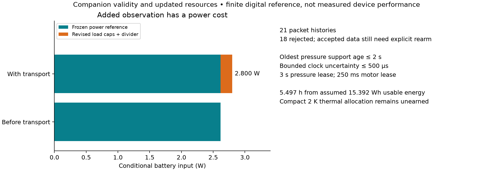

# Monitoring and companion interface studies

This finite digital package connects the [native KiCad design](../monitoring-transport/README.md)
to acquisition scheduling, identity, pressure freshness, leases, queues and
incremental resource calculations. The [design review](../../../docs/stage4/monitoring-transport-design.md)
explains its place in the full proposed SCCI.

## Reproduce and independently audit

From the repository root:

```text
python electronics/stage4/monitoring-transport/verify_monitoring_transport.py
python electronics/stage4/transport-study/transport_contract.py --check
python electronics/stage4/transport-study/verify_transport.py
python electronics/stage4/transport-study/input_study.py
python electronics/stage4/transport-study/verify_input.py
python electronics/stage4/transport-study/verify_integration.py
```

These commands read existing evidence. Intentional generation uses
`transport_contract.py --write-results`, `input_study.py --write-results` and
the auditors' `--write-report` options. Check the actual producer help before
regeneration. Binding failures require reviewing the changed native sources;
they are not permission to replace historical evidence automatically.

[transport-results.json](transport-results.json) stores every raw aperture,
endpoint read, packet history, lease transition and queue allocation.
[input-results.json](input-results.json) and [input-traces.npz](input-traces.npz)
store divider/source loading corners, six artificial waveforms and incremental
power. Separate auditors do not import the producers. The input auditor uses
analytic step superposition, independent KCL residuals and saved-sample interval
intersections. [integration-verification.json](integration-verification.json)
binds cross-package wires and host boundary pins to actual exported connectivity.

## Meaning and limits

The ADS8688 supplies the 450k aggregate conversion schedule. Current channels
average 200 ksps each with 4.25–6.375 µs spacing, rather than uniform 5 µs.
Its typical internal 15 kHz bandwidth filters the observation. The equal-pole
7.5/15/22.5 kHz cases are illustrative filter shapes, **not manufacturer
bandwidth limits**. An extra 30 mA, 1 µs artificial spike shows why samples
cannot certify instantaneous source current. A longer integration window can
recover area under the ideal model; precision calibration, real filter tails,
buffer errors, reference mismatch and clipping remain unearned.

The explicit companion is a 1 Mbaud, 8N1 isolated UART, with external peer power.
Processed feature/pressure packets fit the normal service allocation. Continuous
4k neural-frame raw export does not fit; the diagnostic mode is finite and
exclusive. Packet CRC is error detection. The reserved future envelope bytes
do not implement authentication. Pressure support timestamps, clock bounds,
calibration identity and freshness are required; actual sensor accuracy remains
an external premise.

The added circuits revise the conditional active allocation to approximately
**2.800 W / 5.497 h**, using larger host rail caps and the previous battery,
converter-loss and usable-energy assumptions. The previous six-package budget
is preserved. This overlay earns neither converter efficiency nor compact
implant thermal closure. Target firmware and consolidated PCB implementation
are the next Stage 4 packages.






