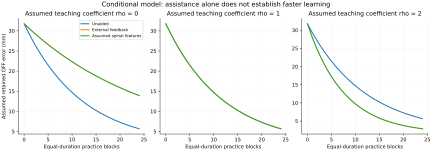
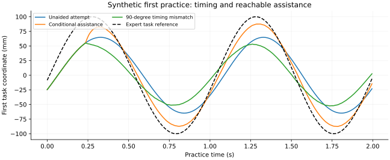

# Conditional future-interface scenario

13 October 2026. **Illustrative model v1 complete.** Start with the
[concept and mechanism](../../../docs/stage3/conditional-concept.md),
[declared protocol](protocol.md) and
[assumption ledger](../../../docs/stage3/conditional-concept/assumption-ledger.csv).
This package instantiates explicit future biological/sensing/delivery premises.
It does not enable or replace any historical actual-delivery pilot.

## What was run

- 128 finite scenarios across four synthetic parameter draws; 24 practice blocks
  each, 3,072 practice blocks and 3,200 per-block assessment rows.
- Five nominal arms, four effective teaching coefficients and four additional
  failure variations. All fixed settings appear in the protocol and summary.
- A causal synthetic spinal phase decoder, external measurement alternative,
  separately estimated learner/program maps, finite frame commands, delayed
  activation and an explicit biological learning law.
- Six mechanism checks plus reproduction of every summary, curve and saved
  first-practice trace. These checks verify this construction, not human efficacy.

## Results

Means over the four synthetic learners, in mm of pooled two-coordinate RMS:

| Assumed teaching coefficient | Unaided final OFF error | External assistance final OFF error | Assumed spinal-feature assistance final OFF error |
|---|---:|---:|---:|
| -1: adverse teaching | 5.667 | 37.626 | 37.641 |
| 0: guidance dependence | 5.667 | 13.918 | 13.919 |
| 1: assistance contribution cancels | 5.667 | 5.667 | 5.667 |
| 2: favorable teaching | 5.667 | 2.884 | 2.884 |

First-practice ON error averages 31.756 mm unaided, 16.157 mm with external
assistance and 16.161 mm with the assumed spinal features. Thus immediate
improvement is compatible with later benefit, no added learning, or harm.

Under the favorable coefficient, the chosen 15 mm pooled OFF threshold is
reached after seven blocks with either assistance method, compared with
10/11/10/10 blocks unaided. This corresponds to 14 s versus 20/22/20/20 s of
**model practice**, but 71 s versus 86/91/86/86 s including the common 36 s
calibration and each 1 s OFF probe/2 s washout. None of these times is a human
training prediction. The 95% persistence factor and all learning coefficients
are assumptions without a fitted retention interval.

The result is conditional on the learning law: algebra gives
`Delta theta = eta [(theta* - theta) + (rho-1) projection(stim_response)]`.
The favorable coefficient deliberately represents useful extra adaptation; the
simulation does not discover that biology has that coefficient. At rho=1,
every arm has the same OFF learning within numerical precision, even though
their ON performance differs substantially.



The external and spinal curves largely overlap. Equal-information external and
spinal-labelled expert references are exactly identical. No unique expert
information, expert-neural increment or useful live-neural advantage is shown
by this simple fully specified cyclic task. A more complicated skill must supply
its own justified information and coordination hypothesis.



The 90-degree phase-shifted arm worsens first-practice error to 35.695 mm on
average. Its OFF outcomes are not uniformly worse: under the adverse coefficient
it can improve final OFF error while delaying threshold crossing. The declared
projection law can change error orientation; no result is suppressed to make
timing appear universally beneficial.

## When assumptions weaken

- **Neural features absent:** the declared external fallback exactly reproduces
  the external policy. This is a change of sensing mode, not successful spinal
  decoding of an absent signal.
- **Neural delay 120 ms:** the predictable 1 Hz cue largely compensates it in
  this scenario; final OFF error is 2.885 mm rather than 2.884 mm. This is not a
  general tolerance of such latency during unpredictable skilled motion.
- **Actual gain halved after calibration:** benefit weakens; final OFF error
  is 3.904 mm external / 3.901 mm spinal. The controller does not secretly receive
  the new true gain. This limited scenario does not implement a general drift
  detector or prove that wrong-route recruitment is tolerable.
- **Recruitment absent:** measured calibration fails the local model criterion,
  all commands are zero and final OFF error equals unaided practice, 5.667 mm.

The construction assumes valid phase features during active practice and an
adequate normalized actuator. Raw contact voltages, AFE recovery, delivered
microsecond pulses, monitor accuracy, tissue recruitment, muscle forces, limb
contact mechanics and chronic packaging are not simulated here. Those remain
separate biological assumptions and detailed-engineering responsibilities.
Model washout retains queued delayed commands before decay and does not qualify
electrode/tissue recovery. No transfer to a new task is established.

## Files and reproduction

| File | Purpose |
|---|---|
| [study.py](study.py) | Model, causal controller, six mechanism checks and optional figures |
| [protocol.md](protocol.md) | Declared settings, resource accounting and boundaries |
| [summary.json](summary.json) | All 128 outcomes, model settings and normalized source identity |
| [learning-curves.csv](learning-curves.csv) | All 3,200 block/assessment rows |
| [first-practice-traces.json](first-practice-traces.json) | Five first-practice target, actual, voluntary, command and response traces |

```text
python experiments/stage3/conditional-concept/study.py --check
```

Dependencies are the repository's existing numpy/matplotlib environment. Running
without `--check` rewrites **only this illustrative package's outputs**. Figures
can be regenerated with `--check --figures`. The historical frozen packages and
their source/receipt identities remain untouched.
